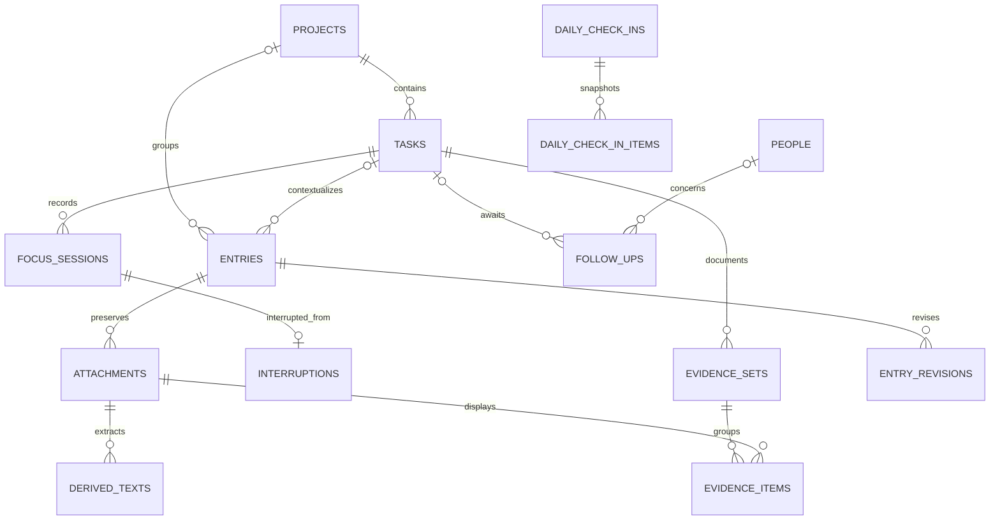

# MySQL database design

## Conventions and installation boundary

Proposed baseline: MySQL 8.4 LTS, InnoDB, `utf8mb4`, strict SQL mode, UTC database connections, and migration-managed schema. Validate supported driver/framework versions in Phase 0. Never use ORM automatic schema synchronization against retained data.

This is a **single-owner database**. All application data belongs to that installation; there are no shared workspaces or teammate login accounts. `users.id` is TINYINT with `CHECK (id = 1)`, permitting at most one owner. Multi-user hosting requires a separate future ownership/isolation design, not simply enabling signup.

Unless noted, each `id` is a primary key containing an application-generated UUID in `CHAR(36)` with ASCII binary collation. API IDs are strings. Standard mutable entities have `created_at DATETIME(3)`, `updated_at DATETIME(3)`, and `version INT UNSIGNED DEFAULT 1`. All instants are UTC; local dates use `DATE`. `?` below means nullable. Lengths are maximum accepted lengths, enforced in DTOs as well as SQL. Controlled vocabularies use VARCHAR plus CHECK constraints and TypeScript enums; changing a vocabulary requires a migration.

Relationships default to `ON DELETE RESTRICT`. Explicitly stated cascades are limited to dependent metadata after authorized deletion. References to people may be retained by archiving contacts instead of deleting them. All foreign keys receive supporting indexes. A row lock/transaction and application validation enforce cross-record rules that SQL CHECK cannot express.

## Relationship overview

The diagram is a subset; the table dictionary and constraints below are authoritative.

## Table dictionary

### 1. users

`id TINYINT PK CHECK(id=1)`, `email VARCHAR(254) UNIQUE`, `display_name VARCHAR(120)`, `password_hash VARCHAR(255)`, `timezone VARCHAR(64)`, `active_focus_session_id CHAR(36)? FK focus_sessions`, `focus_version INT UNSIGNED DEFAULT 0`, `password_changed_at DATETIME(3)`, standard timestamps/version.

The active pointer is introduced after focus_sessions exists. It must reference an open session for this installation. Timezone is an IANA name. Never expose password hashes through API serialization.

### 2. sessions

`id CHAR(36) PK`, `user_id TINYINT FK users`, `token_hash BINARY(32) UNIQUE`, `created_at`, `last_seen_at`, `expires_at`, `revoked_at?` (all DATETIME(3)), `device_label VARCHAR(180)?`.

Store only a hash of the random session secret. Index `(expires_at)` for expiry cleanup. Device label is descriptive, not a trusted identity. No JWT refresh-token table is needed for the selected server-session design.

### 3. people

`id`, `display_name VARCHAR(120)`, `email VARCHAR(254)?`, `handle VARCHAR(120)?`, `notes TEXT?`, `archived_at DATETIME(3)?`, timestamps/version.

Names are not globally unique. Display disambiguation by handle/team. Contact email is not a login identity.

### 4. teams

`id`, `name VARCHAR(120)`, `notes TEXT?`, `archived_at DATETIME(3)?`, timestamps/version. Names need not be globally unique; warn about likely duplicates in UI rather than reject valid names.

### 5. person_teams

`person_id FK people`, `team_id FK teams`, `role_label VARCHAR(120)?`, `created_at`; composite PK `(person_id, team_id)`. A person can belong to multiple teams. Reverse index `(team_id, person_id)`.

### 6. projects

`id`, `name VARCHAR(180)`, `description TEXT?`, `status VARCHAR(16)` = active/completed/archived, `target_date DATE?`, `repository_url VARCHAR(2048)?`, `archived_at DATETIME(3)?`, timestamps/version.

Index `(status, updated_at, id)`. Completed projects remain browsable; starting new work requires explicit reactivation. Status/archive timestamp consistency is validated. No hard project deletion route in R1.

### 7. project_people

`project_id FK projects`, `person_id FK people`, `role_label VARCHAR(120)?`, `created_at`; composite PK and reverse person index. Captures a project-specific role independently of team membership.

### 8. project_teams

`project_id FK projects`, `team_id FK teams`, `created_at`; composite PK and reverse team index. Team association does not automatically make every team member an explicit project contact.

### 9. tasks

`id`, `project_id FK projects`, `title VARCHAR(240)`, `description MEDIUMTEXT?`, `type VARCHAR(24)`, `status VARCHAR(16)`, `priority VARCHAR(8) DEFAULT 'normal'`, `requested_by_person_id FK people?`, `source_entry_id FK entries? UNIQUE`, `next_action TEXT?`, `branch_name VARCHAR(240)?`, `links JSON?`, `deadline_kind VARCHAR(8)?` = hard/target, `due_date DATE?`, `due_at DATETIME(3)?`, `due_timezone VARCHAR(64)?`, `completed_at DATETIME(3)?`, `trashed_at DATETIME(3)?`, timestamps/version.

Types/statuses are in scope. `links` is at most 20 validated `{kind,label,url}` HTTP(S) references; it does not contain secrets. Branch is plain text, never executed.

Indexes: `(project_id,status,updated_at,id)`, `(status,due_date,id)`, `(status,due_at,id)`, `(requested_by_person_id,status)`, `(trashed_at)`, FULLTEXT `(title,description,next_action)`.

CHECK: due_date and due_at cannot both be nonnull; exact due_at requires due_timezone; no deadline means deadline_kind/due_timezone are null. `completed_at` is set for done and cleared on reopening. Only focus commands may produce in_progress. Creating a task from a source entry inserts task then links entry inside one transaction; see circular-FK migration note below.

### 10. entries

`id`, `project_id FK projects?`, `task_id FK tasks?`, `title VARCHAR(240)?`, `entry_type VARCHAR(24)`, `inbox_state VARCHAR(16) DEFAULT 'unprocessed'`, `source_kind VARCHAR(24)` = typed/pasted/upload/recording, `original_text MEDIUMTEXT?`, `content_text MEDIUMTEXT?`, `source_url VARCHAR(2048)?`, `source_label VARCHAR(240)?`, `sender_person_id FK people?`, `occurred_at DATETIME(3)?`, `occurred_timezone VARCHAR(64)?`, `trashed_at DATETIME(3)?`, timestamps/version.

`original_text` is the immutable initial typed/pasted capture; `content_text` is the current editable working representation. Empty text is allowed only with at least one successfully stored attachment in the capture transaction. A task-linked entry must have the task's project. Task/project changes are explicit operations; cross-project links are rejected in R1. Captured time is created_at; occurred_at is an optionally entered event/received time.

Indexes: `(inbox_state,created_at,id)`, `(project_id,occurred_at,created_at,id)`, `(task_id,created_at,id)`, `(sender_person_id,created_at)`, `(trashed_at)`, FULLTEXT `(title,content_text,original_text)`.

### 11. entry_revisions

`id`, `entry_id FK entries`, `revision_no INT UNSIGNED`, `title VARCHAR(240)?`, `content_text MEDIUMTEXT?`, `change_reason VARCHAR(240)?`, `created_at DATETIME(3)`; UNIQUE `(entry_id,revision_no)`.

Append the previous editable content on each content change in the same transaction as updating entry version. Original text is never overwritten. Metadata changes also produce an activity event; a revision need not duplicate unchanged file bytes.

### 12. entry_supersessions

`older_entry_id FK entries PK`, `newer_entry_id FK entries`, `reason TEXT?`, `created_at DATETIME(3)`; index `(newer_entry_id)`; CHECK older != newer.

Each earlier entry has at most one direct successor; one newer entry may replace several earlier entries. Require instruction/decision entry types, same nonnull project, and an acyclic graph. Trashed entries cannot be replacement targets. Relationships can be explicitly removed with an activity event; deletion never quietly breaks the chain.

### 13. attachments

`id`, `entry_id FK entries`, `original_name VARCHAR(255)`, `storage_key VARCHAR(512) UNIQUE`, `mime_type VARCHAR(120)`, `byte_size BIGINT UNSIGNED`, `sha256 BINARY(32)`, `purpose VARCHAR(24)`, `caption TEXT?`, `width INT UNSIGNED?`, `height INT UNSIGNED?`, `duration_ms INT UNSIGNED?`, `thumbnail_key VARCHAR(512)?`, `playback_key VARCHAR(512)?`, `media_state VARCHAR(16)` = pending/ready/unsupported/failed, `ocr_enabled BOOLEAN DEFAULT false`, `created_at`, `trashed_at?`.

Storage keys are server-generated, opaque, private filesystem-relative keys. Original bytes are immutable. Thumbnail/playback assets are disposable derivatives. No byte deduplication across entries in R1: hash supports integrity and per-entry duplicate warnings, not automatic merging. Index `(entry_id,created_at,id)`, `(trashed_at)`.

### 14. derived_texts

`id`, `attachment_id FK attachments`, `kind VARCHAR(16)` = ocr/transcript, `revision_no INT UNSIGNED`, `engine VARCHAR(120)`, `model_version VARCHAR(120)?`, `language VARCHAR(64)?`, `machine_text MEDIUMTEXT`, `segments JSON?`, `reviewed_text MEDIUMTEXT?`, `search_text MEDIUMTEXT`, `review_state VARCHAR(16)` = unreviewed/reviewed, `reviewed_at DATETIME(3)?`, `is_current BOOLEAN`, timestamps/version.

UNIQUE `(attachment_id,kind,revision_no)`. Index `(attachment_id,kind,is_current)`, FULLTEXT `(search_text)`. Maintain search_text transactionally as reviewed_text when nonnull, otherwise machine_text; this avoids matching a discarded machine error after review. Add generated nullable `current_slot VARCHAR(16)` = kind when is_current, otherwise NULL; UNIQUE `(attachment_id,current_slot)` enforces one current output per kind. Retry creates a new revision; it never overwrites prior reviewed output. Replace-current transition occurs only on successful output publication. Empty reviewed text is a valid intentional correction; use nullness, not truthiness, when selecting searchable text.

Segments, when supplied, are an array of `{startMs,endMs,text}` bounded by duration. Initial search uses reviewed_text when nonnull; otherwise machine_text. Preserve machine segments even after edits; display timestamp jumps as approximate after text corrections.

### 15. focus_sessions

`id`, `task_id FK tasks`, `started_at DATETIME(3)`, `ended_at DATETIME(3)?`, `end_reason VARCHAR(16)?` = pause/switch/wait/done/cancel, `checkpoint_entry_id FK entries?`, `created_at`.

Index `(task_id,started_at,id)`. Add generated nullable `open_slot TINYINT` = 1 when ended_at IS NULL, otherwise NULL; UNIQUE `(open_slot)` enforces at most one open session in this single-owner database. CHECK ended_at >= started_at; an end reason accompanies ended_at. User active pointer and task status must agree with the open row after every command.

### 16. interruptions

`id`, `from_focus_session_id FK focus_sessions UNIQUE`, `to_focus_session_id FK focus_sessions UNIQUE`, `created_at`. CHECK from != to. Edges connect the closed and newly opened sessions created by one switch; graph edges are historical and are not edited to simulate return order.

### 17. follow_ups

`id`, `project_id FK projects?`, `task_id FK tasks?`, `person_id FK people?`, `source_entry_id FK entries?`, `question TEXT`, `status VARCHAR(16)` = waiting/answered/cancelled, `follow_up_on DATE?`, `resolution TEXT?`, `resolved_at DATETIME(3)?`, timestamps/version.

Task implies matching project; person is optional when the responder is unknown. One follow-up can exist without a task. Index `(status,follow_up_on,id)`, `(person_id,status)`, `(project_id,status)`, `(task_id,status)`. Answering a question does not automatically mark a task done or start it.

### 18. daily_check_ins

`id`, `local_date DATE UNIQUE`, `timezone VARCHAR(64)`, `intended_outcome TEXT?`, `interruption_notes TEXT?`, `deadline_notes TEXT?`, `waiting_notes TEXT?`, `reflection TEXT?`, timestamps/version.

One row per local date in the single-owner installation. Store the timezone used on that date. Creating a past check-in is allowed and uses an explicit date. Initial Today suggestions are live calculations, not additional database columns.

### 19. daily_check_in_items

`id`, `check_in_id FK daily_check_ins`, `section VARCHAR(16)` = current/paused/due/waiting, `task_id FK tasks?`, `follow_up_id FK follow_ups?`, `project_id FK projects?`, `snapshot JSON`, `sort_order INT UNSIGNED`.

Exactly one of task_id/follow_up_id/project_id is nonnull. Current/paused accepts tasks, waiting accepts follow-ups, and due accepts tasks or projects. Snapshot includes label, status, project label, relevant dates and next action as shown at save. Index `(check_in_id,section,sort_order)`. Replace that day's item collection atomically with a versioned check-in save; old days remain unchanged. A trashed linked item still renders its snapshot.

### 20. evidence_sets

`id`, `task_id FK tasks`, `title VARCHAR(240)`, `notes TEXT?`, timestamps/version. Index `(task_id,created_at,id)`.

### 21. evidence_items

`id`, `evidence_set_id FK evidence_sets`, `attachment_id FK attachments`, `side VARCHAR(16)` = before/after/reference, `caption TEXT?`, `viewport_label VARCHAR(120)?`, `captured_at DATETIME(3)?`, `sort_order INT UNSIGNED`.

UNIQUE `(evidence_set_id,attachment_id)`; index `(evidence_set_id,side,sort_order)`. Require an image attachment linked to the same task through its entry. A reused attachment is referenced, not copied. Deleting an evidence set removes its grouping items, not source files.

### 22. activity_events

`id`, `event_type VARCHAR(64)`, `project_id FK projects?`, `task_id FK tasks?`, `entry_id FK entries?`, `payload JSON`, `created_at DATETIME(3)`.

Append inside the domain transaction for significant mutations. Payload has an allowlisted schema with relevant before/after values, not credentials or full duplicated audio/transcripts. Index `(project_id,created_at,id)`, `(task_id,created_at,id)`, `(entry_id,created_at,id)`. This is an application history log, not tamper-proof audit certification. Purge redacts/removes source text and identifying labels from affected payloads.

### 23. processing_jobs

`id`, `kind VARCHAR(24)` = inspect_media/ocr/transcribe/export/purge_files, `attachment_id FK attachments?`, `status VARCHAR(16)` = queued/running/succeeded/failed/cancelled, `input JSON`, `result JSON?`, `attempts INT UNSIGNED DEFAULT 0`, `max_attempts INT UNSIGNED DEFAULT 3`, `available_at DATETIME(3)`, `lease_token CHAR(36)?`, `lease_expires_at DATETIME(3)?`, `last_error_code VARCHAR(64)?`, `last_error_message VARCHAR(500)?`, `dedupe_key VARCHAR(191)?`, timestamps/version.

Index `(status,available_at,id)`, `(lease_expires_at)`. A generated nullable active_dedupe_key derived from dedupe_key only while queued/running has a UNIQUE index. Repeated active requests return the same job. Completed retries use a new job. Export result stores a private bundle key, checksum, byte size, and expires_at; no public URL. Cleanup of expired bundles is scheduled separately. Input JSON is validated per kind; file paths are never accepted from clients.

### 24. command_receipts

`command_key CHAR(36) PK`, `operation VARCHAR(80)`, `request_hash BINARY(32)`, `result_status SMALLINT UNSIGNED`, `result JSON`, `created_at`, `expires_at`.

Store final receipts for capture, task conversion, and focus commands in the mutation transaction. Same key + same operation/hash returns the prior result; different request returns 409. Retain seven days initially; index expiry. Large file bodies are represented by stable file hashes and metadata in request_hash. A rolled-back mutation must not leave a successful receipt. On permanent source deletion, replace receipt payloads containing that source with a minimal 410 tombstone; keep request hash/key until expiry to prevent replay recreating deleted data.

## Transactions and invariants

### Atomic focus command

1. Start transaction; lock singleton users row with SELECT FOR UPDATE.
2. Check committed command receipt first; return it if request matches.
3. Compare expectedFocusVersion; stale version → 409 without writes.
4. Lock relevant tasks in stable ID order; reject unavailable tasks/projects.
5. Close current session before inserting the new one, satisfying UNIQUE open_slot.
6. Store optional checkpoint entry, mutate task status/next action, create new session/edge as applicable.
7. Update active pointer and increment focus_version; append events and receipt; commit.

All task status writes that affect the active task use this same service/lock order. Never permit generic PATCH to set in_progress or bypass session closure. Status changes on an inactive task still verify it did not become active concurrently. Deadlock retries are bounded; retries reuse the command key.

### Other required transactions

- Entry edit + previous-content revision + activity event + version increment.
- Source-to-task conversion + entry linkage + activity event + receipt.
- Supersession graph validation/insertion with singleton lock to serialize changes, including cycle detection.
- Daily check-in version check + fields + replacement snapshot items.
- Processing result publication + is_current swap + job success; lease token must still match.
- Trash/purge request + visibility change + job cancellation + cleanup job creation. Filesystem deletion occurs later and is idempotent.

## Migration order

1. users without active pointer FK; people/teams/projects and association tables.
2. tasks without source_entry FK; entries; add source_entry FK to tasks.
3. revisions/supersessions/attachments/derived texts.
4. focus_sessions/interruptions; add users.active_focus_session_id FK.
5. follow-ups/check-ins/evidence/events/jobs/receipts; sessions as soon as users exists.

Create indexes and CHECK constraints in the owning migration. Test a fresh migration and upgrade from the previous release against real MySQL. Seed fictional demo data separately from the owner-bootstrap command.

## Search, history, and deletion notes

Use database FULLTEXT for eligible text and a bounded escaped literal search fallback for short technical tokens or unsupported tokenization. Union authorized results from tasks, entries, derived texts, people, and teams in the application search query; avoid an external search cluster initially. Exclude trash and noncurrent extraction revisions by default. Return a hit's source entity and attachment/segment context.

Project history orders by effective event time (occurred_at when supplied, otherwise created_at), then stable ID; UI also shows captured time. System activity uses its creation time. Index/query-plan review determines whether an extra persisted effective-time column is worthwhile; it is not required before measuring.

Task moves across projects are out of R1 because entries/evidence/follow-ups would need coordinated migration. Entry organization may assign an unlinked entry to a project/task; changing a linked entry's project requires unlinking first. Preserve source metadata throughout.

Foreign-key restrictions are intentional. R1 primarily archives projects and trashes tasks. Permanent entry/file removal explicitly detaches affected evidence and output rows, removes supersession/conversion relationships only after confirmation, and redacts relevant events in a controlled service transaction. Never use a generic cascading “delete everything” endpoint.
