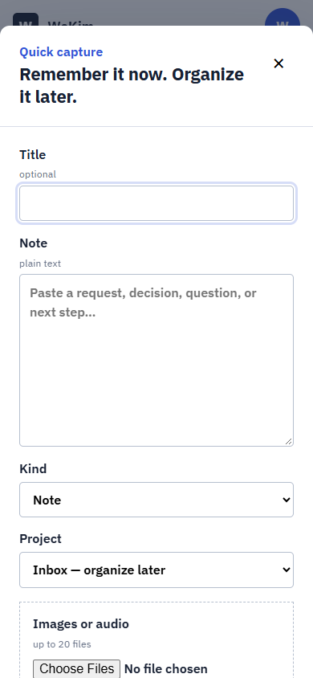
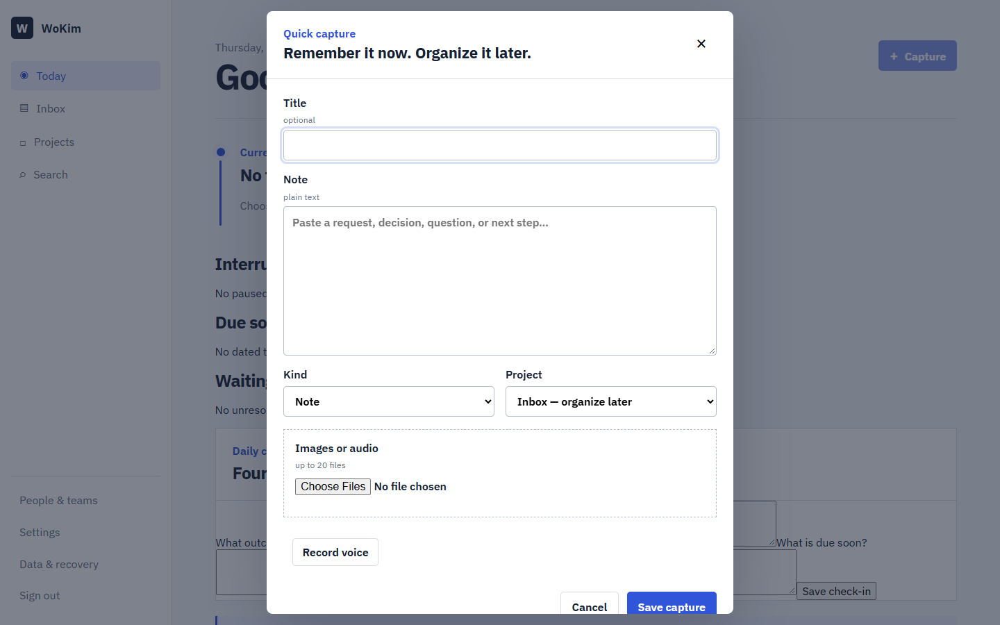

# WoKim user guide

WoKim is a private work memory for one developer. It keeps the received source, your evolving notes, the current task direction, and the trail of interruptions without turning capture into project administration.

## Capture first

Use **Capture** from anywhere. A title and project are optional; leaving the project as **Inbox — organize later** is expected. You can also select an existing task, sender/person, received time, and attachment purpose before saving. Add plain text, up to 20 images/audio files, or record a voice note. A recording is previewed before save and can be discarded. Closing a text draft preserves its metadata and text locally for seven days unless you explicitly discard it.

Files are saved before OCR or transcription. Processing failure never deletes the original. Audio over ten minutes remains stored but is rejected for processing.

## Organize and preserve context

- Inbox holds unorganized captures. Filter by type, project, person, or date; each row shows its source, attachments, and processing state. Open one to link it to a project/task/person, add more image/audio files, revise the working note, dismiss it, or move it to recoverable trash.
- Turning an entry into a task keeps the original entry and its attachments. Retrying the conversion returns the same task.
- Use instruction/decision entries and explicit supersession links when direction changes. Earlier wording stays readable; WoKim does not silently rewrite history.
- Projects combine overview, tasks, history, decisions, people/teams, and evidence. The overview shows the latest checkpoint, current tasks, open questions, and recent changes so re-entry does not require reconstructing context; project details and repository link can be edited there. Archive finished context instead of deleting it.
- People & teams supports name search, active/archived views, editing, archiving, and restoration. A person’s context page collects projects, teams, requested tasks, related captures, and follow-ups.

## Work and resume

Only **Start/Resume** begins focus. Switching from one task to another atomically pauses the old task, records the interruption, and starts the new one. Add an optional checkpoint or next action when pausing. Finishing a task offers earlier paused work but never starts it automatically.

Today shows current focus, paused work, due/overdue work, waiting follow-ups, and four short check-in questions. Saving a check-in records intent; it does not start a timer or change task state. Open a dated history link to review an earlier check-in.

## Follow-ups and evidence

Create a follow-up when a person owes an answer or action. Link it to a task/source and set an optional follow-up date. Resolving it records the response but does not complete or start a task.

Evidence sets reference existing images without copying their bytes. Use labels/captions and ordering for before/after/reference comparisons; incomplete comparisons are allowed.

## Search and processing

Search covers entries, extracted text, tasks, people, and teams with type/project/person/date/status filters. It updates after a short pause, cancels stale requests, keeps the query and filters in the URL, and loads bounded result pages on demand. Reviewed OCR/transcript text is searchable in place of the machine draft.

List APIs return bounded pages. Integrations should follow the opaque `page.nextCursor` value without editing it and must reuse the same filters for the next request; cursors are signed and rejected if changed or reused with different filters. The current first-party screens request up to 100 items per list.

Enable processing under **Processing**. OCR is explicit per image; automatic transcription for new audio is optional. Review/correct extracted text from attachment detail. A failed retryable job can be retried without replacing its prior record. The immutable machine version, reviewed version, and original file all remain available.

## Data and recovery

Data & recovery shows storage capacity, backup freshness/failure, queued/failed jobs, exports, and trash. Export creates a private, authenticated ZIP with versioned JSON, readable Markdown, all extraction revisions, checksums, and originals; it expires after 24 hours.

New file uploads stop with a clear storage-high-water error before the private volume is exhausted (95% used or less than 1 GiB projected free by default). Reads and exports remain available so space can be recovered safely; operators can tune both thresholds.

Trash is recoverable for 30 days by default. Permanent purge is explicit and can be blocked by task/source/evidence dependencies. Old backups may retain purged content until backup retention expires.

Use **Restore** to return a trashed record. **Purge** requires typing `PURGE`; it permanently removes the live record or reports the dependency/stale-version reason it could not proceed. Processing settings also provide a sample-capture shortcut for exercising OCR or transcription with the ordinary preserved-source workflow.

Change your password, timezone, and sessions in Settings. Revoke unfamiliar sessions immediately. There is no public signup or password-reset email flow; owner recovery is an operator command.

## Current limitations

- WoKim is online-only; only unfinished text drafts are local. There is no offline synchronization.
- It is single-owner. Do not enable public signup or expose it as a shared service without redesigning ownership checks.
- Transcription is private and local, but accuracy is not authority. Always compare important names, dates, and instructions with the original audio.
- Actual Android/iPhone microphone/codec behavior and representative received clips still need owner testing.
